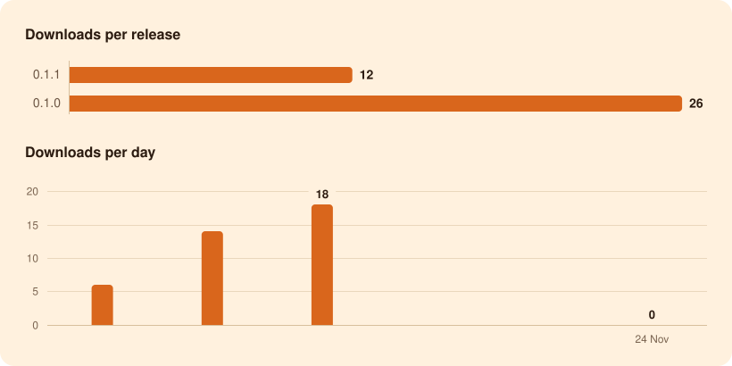

<h1 align="center">38 downloads</h1>

of Nexora for Windows, from GitHub since 18 Nov 2026 Latest release, 0.1.1: <b>12</b> · Last 7 days: <b>38</b> · <b>0</b> stars on GitHub

## Per release

| Release | Published | Download button | Versioned installer | Portable zip | Other files | Total |
| --- | --- | --: | --: | --: | --: | --: |
| [0.1.1](https://github.com/dasunjlk/Nexora/releases/tag/v0.1.1) | 21 Nov 2026 | 1 | 10 | 1 | — | 12 |
| [0.1.0](https://github.com/dasunjlk/Nexora/releases/tag/v0.1.0) | 18 Nov 2026 | 1 | 23 | 1 | 1 | 26 |
| **All releases** | | **2** | **33** | **2** | **1** | **38** |

## Per day

| Day | Downloads |
| --- | --: |
| Today | 0 |
| 24 Nov 2026 | 0 |
| 23 Nov 2026 | 0 |
| 22 Nov 2026 | 0 |
| 21 Nov 2026 | 18 |
| 20 Nov 2026 | 14 |
| 19 Nov 2026 | 6 |

## On GitHub

0 stars · 0 forks · 0 watching

How we count

- GitHub counts every download of a release file. The Download button on the [website](https://dasunjlk.github.io/Nexora/) and in the README always fetches `Nexora-Setup.exe` from the newest release; the versioned installer and the portable zip are on each release's page.
- GitHub updates its counters every few minutes, so for a while a counter may not show a CI download that is already taken off. Each file's number keeps its highest reading, so numbers only go up.
- Still in the numbers: our own check of each new release (one download through the Download button) and any bots. GitHub can't tell those apart.
- Nexora itself sends nothing: no accounts, no tracking. These are GitHub's download counters, read every hour.
- GitHub keeps no dates for downloads, so everything before the first reading counts on 19 Nov 2026.
- Page views and clones need a `METRICS_TOKEN` repository secret: a fine-grained token for this repository with Administration: Read-only. GitHub keeps them for 14 days only.

Updated 25 Nov 2026, 03:10 UTC by [Download stats](https://github.com/dasunjlk/Nexora/actions/workflows/metrics.yml), every hour · Data: [downloads](data/downloads.csv), [CI downloads](data/ci-downloads.csv), [stars](data/repo.csv), [summary.json](summary.json)
