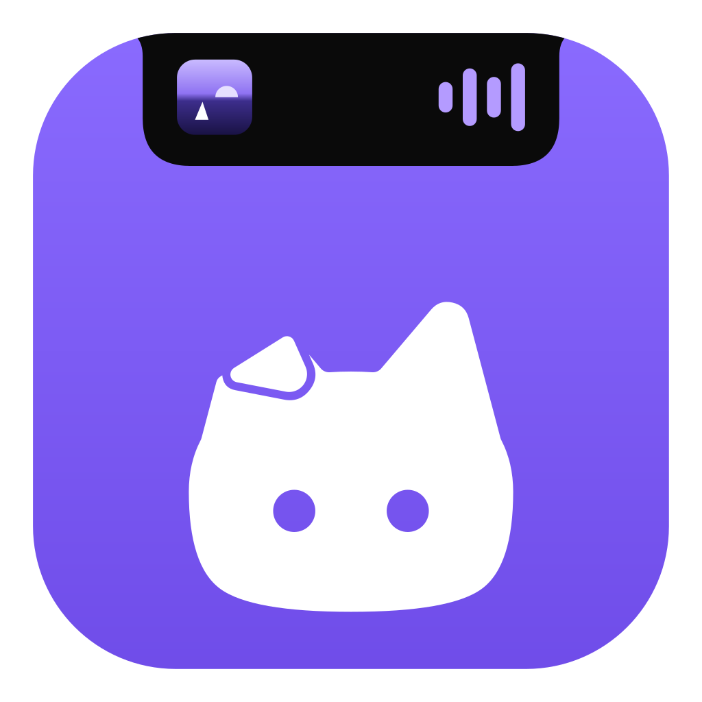

<p align="center"></p>

<h1 align="center">Nexora</h1>

<h3 align="center">A living notch for Windows and Mac</h3>

<p align="center">Like the Dynamic Island on a phone, for your computer. A small island hangs
from the top of your screen, shows what's playing, counting down and arriving,
and opens into quick pages when you point at it.</p>

<p align="center">
  <a href="#features">Features</a>
  &nbsp;·&nbsp;
  <a href="#build">Build</a>
  &nbsp;·&nbsp;
  <a href="#testing">Testing</a>
  &nbsp;·&nbsp;
  <a href="#docs">Docs</a>
  &nbsp;·&nbsp;
  <a href="LICENSE">License</a>
</p>

<p align="center">
  <a href="https://github.com/dasunjlk/Nexora/releases/latest"></a>
  <a href="https://github.com/dasunjlk/Nexora/actions/workflows/ci.yml"></a>
  <a href="LICENSE"></a>
  
</p>

## Features

- **Music, word by word** — controls for whatever is playing, synced lyrics
  (LRCLIB, or Apple Music with your own token), pronunciation under
  Japanese/Korean/Chinese lines.
- **Live activities at rest** — album art and the sung line, focus timer,
  volume and charging, Bluetooth headphones, the next prayer.
- **Controls** — Wi-Fi, Bluetooth, hotspot, the power mode, Project and
  airplane mode, switchable from one main tab.
- **Quick pages** — Music, Today, Shelf, Tasks, Focus, AI usage, and the
  Nexora account tab; add-on pages for System, Stocks, Caffeine, Health,
  IELTS, **Meeting notes**, Script reader, Prayer times, Downloads and more.
- **Phone drop** — send files from any phone to the Shelf over your Wi-Fi
  (no app needed), or from any network once paired.
- **Show over games** — FPS, GPU and CPU while a full-screen game is in front.
- **Themes** — Classic, Nova (the mascot), Glass, Pill and Diorama.
- **Meeting notes** — one click records your microphone and the PC's sound
  together; the notes come back as a Markdown file with a summary, decisions,
  action items and the transcript.
- **Everything is free** — no Pro tier, no locked features, no account
  required for any of it.
- **Light by design** — native Rust, no web view, GPU-drawn in step with your
  display, and nothing runs while nothing moves.

## Build

Requirements: Rust stable with the MSVC toolchain (Windows), Python 3 (tools),
Node 20+ (server tests).

```
cargo test -p nexora-core -p nexora-usage -p nexora-diorama   # logic tests, any OS
cargo build -p nexora --release                               # target\release\nexora.exe
```

Cross-type-check the Mac app from Windows/Linux: `rustup target add
aarch64-apple-darwin` then `cargo mcheck`.

## Testing

```
cargo test --workspace --release
node --test server/test/*.test.mjs        # the phone-drop server
target\release\nexora.exe --selftest out  # scripted screenshots + report.json
```

## Docs

| Document | What |
|---|---|
| [docs/product.md](docs/product.md) | product brief |
| [docs/design.md](docs/design.md) | brand and system design |
| [docs/task.md](docs/task.md) | task board (what's done, on which branch) |
| [docs/branching.md](docs/branching.md) | branch strategy |
| [docs/ci.md](docs/ci.md) | CI pipelines |
| [docs/rebranding.md](docs/rebranding.md) | name mapping and rename policy |
| [docs/features/meeting-notes.md](docs/features/meeting-notes.md) | complete Meeting notes implementation |
| [ARCHITECTURE.md](ARCHITECTURE.md) | how the pieces fit |
| [PRIVACY.md](PRIVACY.md) | every network request the app makes |

## Status

Early. The port of the reference implementation to the Nexora brand is in
progress — see [docs/task.md](docs/task.md). Issues and pull requests are
welcome.

## Credits

- Synced lyrics come from [LRCLIB](https://lrclib.net). QR codes from
  [qrcodegen](https://github.com/nayuki/QR-Code-generator). WebRTC from
  [str0m](https://github.com/algesten/str0m). Prayer-time math from
  [Adhan](https://github.com/batoulapps/adhan-js). Built with
  [windows-rs](https://github.com/microsoft/windows-rs) and [serde](https://serde.rs).
- Nexora is a rebrand of an MIT-licensed upstream implementation; the port
  keeps that provenance in [THIRD-PARTY-NOTICES.txt](THIRD-PARTY-NOTICES.txt).

## License

The code is [Apache-2.0](LICENSE). The Nexora name, its logo and the Nova
mascot (the files in `docs/brand`, `installer/art` and the app icon) are not
covered by it — please don't reuse them in other projects.
